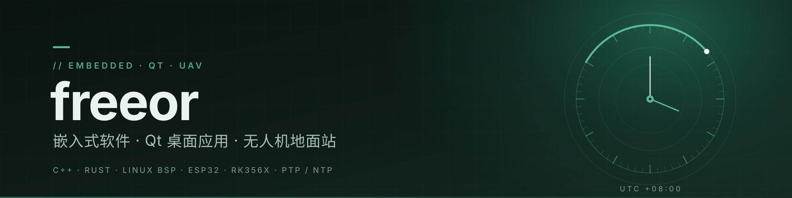

  

  &nbsp;&nbsp;
  &nbsp;&nbsp;
  &nbsp;&nbsp;
  &nbsp;&nbsp;
  &nbsp;&nbsp;
  &nbsp;&nbsp;
  

嵌入式软件、Qt 桌面应用与无人机地面站，是我日常的三条主线：从板级驱动与 BSP，到 Qt/C++ 工具链，再到无人机、遥控器与图传链路。

> 板子要跑得稳，时钟先要对得准。

## 代表项目

| 项目 | 简介 | 主要技术 |
| --- | --- | --- |
| [Makeitdo](https://github.com/652436962/Makeitdo) | Switch 风格的 Linux 开源掌机，基于 Orange Pi CM4 / RK3566，内置 ELRS 射频可遥控无人机与小车，含硬件方案、结构文档和充电器固件 | C · Linux · RK3566 |
| [xunwei-docs](https://github.com/652436962/xunwei-docs) | 迅为 iTOP-3568 开发板驱动开发指南的 Markdown 版，拆分版与合并版共用全书插图 | 嵌入式 Linux · Markdown |
| [pc-ptp-ntp-guide](https://github.com/652436962/pc-ptp-ntp-guide) | PC 硬件平台上的精密网络时间同步实践：PTP、NTP 与网卡时间戳 | PTP · NTP · 网络 |
| [timesync-client](https://github.com/652436962/timesync-client) | Qt 6 / QML 桌面时间同步客户端，8 个页面按 FigCraft 设计稿实现；真实 SNTP 探测公网 NTP，多源择优、偏差告警、同步历史与事件日志 | Qt 6 · QML · SNTP |
| [QMDemo](https://github.com/652436962/QMDemo) | Qt 日常开发的功能模块与三方库示例：FFmpeg、OpenCV、Web、QGraphicsView、OpenGL、网络编程、数据库、QSS 等 | C++ · Qt |
| [QML-Tutorial](https://github.com/652436962/QML-Tutorial) | 面向初学者的 QML 系统教程，8 个交互章节加一个综合实战项目 | QML · Qt Quick |
| [ESP32_remote_car](https://github.com/652436962/ESP32_remote_car) | ESP32 + L298N 遥控小车的源码与资料 | C++ · ESP32 |
| [QtSerialAssist](https://github.com/652436962/QtSerialAssist) | 基于 Qt 的串口调试助手 | C++ · Qt |
| [CppDesignPattern](https://github.com/652436962/CppDesignPattern) | 22 种设计模式的 C++ 实现 | C++ |

## 最近在写

  

**TimeSync 时间同步客户端** — Qt 6 / QML，8 个页面

按 FigCraft 设计稿实现的桌面客户端，后台用 SNTP 探测公网 NTP：多源择优、偏差告警、同步历史与事件日志。界面上的每一个毫秒，都来自 UDP/123 的真实往返。

[源码](https://github.com/652436962/timesync-client) · [构建与截图](https://github.com/652436962/timesync-client/blob/main/README.md)

## GitHub 活跃度

  

## 了解更多

- 开发笔记与教程：[qtkaifajingyan](https://github.com/652436962/qtkaifajingyan)、[CppNote](https://github.com/652436962/CppNote)、[rust-learning-tutorial](https://github.com/652436962/rust-learning-tutorial)
- 硬件与板卡：[opi-rockchip-3b-rgb-led-matrix](https://github.com/652436962/opi-rockchip-3b-rgb-led-matrix)、[sdk_build](https://github.com/652436962/sdk_build)

---

把时间对到 1 ms 以内 · 有问题请在对应仓库开 Issue

